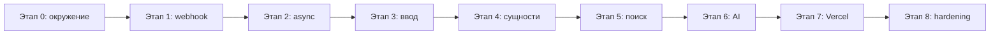

# План реализации FindOrigin

Поэтапный порядок работ по спецификации из [PROJECT.md](./PROJECT.md).

---

## Этап 0. Подготовка окружения

1. Инициализировать проект **Next.js** (App Router) с TypeScript.
2. Добавить зависимости: HTTP-клиент для Telegram API, парсинг HTML (если нужен для внешних страниц), SDK для AI-провайдера.
3. Описать переменные окружения в `.env.example`:
   - `TELEGRAM_BOT_TOKEN`
   - ключи поиска (например, Serper / Tavily / Bing — по выбранному сервису)
   - ключ AI (OpenAI / Anthropic / совместимый API)
   - `TELEGRAM_WEBHOOK_SECRET` (опционально, для проверки запросов)
4. Обновить `.gitignore`, убедиться, что `.env` не коммитится.
5. Зафиксировать минимальную структуру каталогов:
   - `app/api/telegram/webhook/route.ts` — webhook
   - `lib/telegram/` — клиент Bot API
   - `lib/extract/` — извлечение текста и сущностей
   - `lib/search/` — поиск источников
   - `lib/ai/` — сравнение смысла и ранжирование

---

## Этап 1. Минимальный Telegram webhook (требование «быстрый 200»)

1. Реализовать **POST**-обработчик `app/api/telegram/webhook/route.ts`:
   - разбор JSON `update`;
   - извлечение `chat.id` и `text` из `update.message` (игнорировать не-текстовые апдейты или отвечать подсказкой);
   - немедленный ответ **200 OK** с пустым телом.
2. Реализовать `lib/telegram/sendMessage.ts` — вызов `sendMessage` через Bot API.
3. На первом шаге: после парсинга отправить эхо или «Обрабатываю…» и вернуть 200 **до** любой долгой логики (см. этап 2 для фоновой обработки).
4. Локально: туннель (ngrok / cloudflared) + `setWebhook` на URL Vercel или локальный URL для отладки.
5. Проверить вручную: сообщение боту → ответ в чате.

**Критерий готовности:** бот стабильно принимает текст и отвечает; webhook не таймаутится Telegram.

---

## Этап 2. Асинхронная обработка (чтобы не блокировать webhook)

1. Вынести полный пайплайн поиска в отдельную функцию `processUserInput(chatId, rawInput)`.
2. В webhook после быстрого `sendMessage` («Ищу источники…») запускать обработку **без ожидания** в рамках того же запроса:
   - предпочтительно: `waitUntil` (Vercel) или фоновый вызов с коротким таймаутом;
   - альтернатива на раннем этапе: отдельный internal API route + `fetch` без await (с оговоркой по надёжности на Vercel).
3. По завершении — второе `sendMessage` с результатом или ошибкой.
4. Добавить простую защиту от дублей / rate limit на `chat.id` (in-memory или KV позже).

**Критерий готовности:** webhook всегда < 1–2 с; длинный поиск не рвёт соединение.

---

## Этап 3. Нормализация ввода (текст и ссылка на пост)

1. Определить тип ввода:
   - произвольный текст;
   - URL `t.me/...` или `https://telegram.me/...`.
2. Для ссылок на пост:
   - распарсить канал и `message_id`;
   - получить текст поста (публичный preview / embed / Bot API `copyMessage` / парсинг публичной страницы — выбрать один поддерживаемый путь и задокументировать ограничения).
3. Единый интерфейс: `normalizeInput(raw: string) → { text: string, metadata?: ... }`.
4. Обработать пустой текст, неподдерживаемые ссылки — понятное сообщение пользователю.

**Критерий готовности:** из ссылки на публичный пост извлекается текст для дальнейшего анализа.

---

## Этап 4. Извлечение сущностей из текста

1. Реализовать модуль `lib/extract/entities.ts`:
   - ключевые утверждения (1–N формулировок для поиска);
   - даты;
   - числа;
   - имена / организации;
   - исходные ссылки из текста.
2. Комбинировать правила (регулярки для дат, чисел, URL) и **один компактный запрос к AI** со структурированным JSON-ответом (schema).
3. Сохранить «поисковый запрос» (query) для этапа поиска — склейка утверждений + важные сущности.

**Критерий готовности:** на тестовых постах стабильно получается структура сущностей и search query.

---

## Этап 5. Поиск возможных источников в сети

1. Подключить API веб-поиска (один провайдер на MVP).
2. Сформировать 2–4 поисковых запроса из сущностей (официальные источники, новости, блоги, исследования — через разные формулировки или site:-ограничения где уместно).
3. Собрать топ-N уникальных URL (дедупликация доменов, отсечение соцсетей-копипаста при необходимости).
4. Для каждого кандидата — кратко получить сниппет или выдержку страницы (fetch + извлечение основного текста, с лимитом размера и таймаутом).

**Критерий готовности:** на входе утверждение → список из 5–15 кандидатов с заголовком, URL и фрагментом текста.

---

## Этап 6. Семантическое сравнение с AI и финальный ответ

1. Промпт: сравнить **смысл** исходного текста с каждым кандидатом (не literal match).
2. Попросить модель вернуть JSON:
   - 1–3 лучшие ссылки;
   - краткое обоснование на русском;
   - оценка уверенности (например, «высокая / средняя / низкая» или 0–100).
3. Форматировать ответ для Telegram (MarkdownV2 или plain text с экранированием).
4. Если источников не найдено — честное сообщение и что пользователь может уточнить.

**Критерий готовности:** пользователь получает 1–3 ссылки с уверенностью и пояснением.

---

## Этап 7. Деплой на Vercel

1. Подключить репозиторий к Vercel, прописать env в dashboard.
2. Задеплоить production URL.
3. Вызвать `setWebhook` на `https://<domain>/api/telegram/webhook`.
4. Проверить логи Vercel и сценарии: текст, ссылка, ошибка API, таймаут поиска.

**Критерий готовности:** бот работает в production без локального туннеля.

---

## Этап 8. Качество, безопасность, эксплуатация

1. Валидация входящего webhook (secret token / проверка структуры update).
2. Логирование без утечки токенов и полного текста пользователя (или с редакцией).
3. Лимиты длины сообщения Telegram (разбивка длинного ответа).
4. Обработка ошибок внешних API с понятными сообщениями пользователю.
5. Минимальный набор ручных тест-кейсов в `docs/` или комментарии в README (как прогнать сценарии).

**Критерий готовности:** предсказуемое поведение при сбоях; нет секретов в логах.

---

## Этап 9 (опционально, после MVP)

- Очередь задач (Vercel KV / Upstash) для надёжной фоновой обработки.
- Кэш результатов по хешу текста.
- Команды `/help`, `/about`.
- Метрики (количество запросов, latency по этапам).
- Поддержка медиа-постов (caption как текст).

---

## Порядок коммитов (рекомендуемый)

| # | Содержание |
|---|------------|
| 1 | Scaffold Next.js + env example |
| 2 | Webhook + sendMessage (эхо) |
| 3 | Фоновая обработка + статусное сообщение |
| 4 | normalizeInput + Telegram-ссылки |
| 5 | extract entities + search query |
| 6 | Web search + fetch snippets |
| 7 | AI ranking + формат ответа |
| 8 | Vercel deploy + webhook prod |
| 9 | Hardening (secret, errors, limits) |

---

## Зависимости между этапами

Реализацию начинать строго с этапов 0–2, чтобы бот был живым до подключения AI и внешнего поиска.
